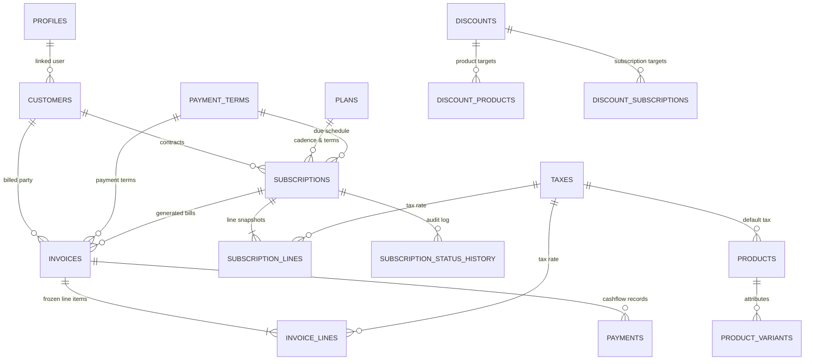

# Database Architecture, Schemas & Security Matrix

> **System:** Brightloop Subscription Management System (SMS)  
> **Database Engine:** PostgreSQL 15+ (Hosted on Supabase, `ap-south-1` Mumbai)  
> **Database Authority:** All financial arithmetic, state transitions, idempotency guards, and security policies are enforced strictly in pure PL/pgSQL database functions and triggers.  
> **Release:** v1.0.0  

---

## 1. Relational Topology & Entity Map

The database contains 20 core relational tables designed for financial integrity:



### Table Definitions & Primary Keys

| Table Name | Primary Key | Key Foreign Keys | Purpose |
|---|---|---|---|
| `profiles` | `id` (UUID) | `auth.users(id)` | Identity profile with role assignment (`admin`, `staff`, `customer`). |
| `customers` | `id` (UUID) | `profiles(id)` | Billing party with unique case-insensitive email and address info. |
| `payment_terms` | `id` (UUID) | None | Due date calculation rule (e.g. Immediate, Net 15, Net 30). |
| `taxes` | `id` (UUID) | None | Percentage tax tiers (e.g. GST 18%, VAT 5%, Zero Tax 0%). |
| `products` | `id` (UUID) | `taxes(id)` | Sellable catalog goods and services with sales and cost prices. |
| `product_variants` | `id` (UUID) | `products(id)` | Surcharge adjustments for attribute-value combinations. |
| `plans` | `id` (UUID) | None | Cadence (`daily`, `weekly`, `monthly`, `yearly`), min quantity, and capability switches. |
| `quotation_templates` | `id` (UUID) | `plans(id)` | Reusable commercial offers with default validity windows. |
| `quotation_template_lines` | `id` (UUID) | `quotation_templates(id)`, `products(id)` | Predefined product items with preset quantities. |
| `discounts` | `id` (UUID) | None | Fixed or percentage discounts with start/end windows and usage caps. |
| `discount_products` | Composite | `discounts(id)`, `products(id)` | Product-scope discount link table. |
| `discount_subscriptions`| Composite | `discounts(id)`, `subscriptions(id)`| Subscription-scope discount link table. |
| `subscriptions` | `id` (UUID) | `customers(id)`, `plans(id)`, `payment_terms(id)` | Core recurring contract and lifecycle state record. |
| `subscription_lines` | `id` (UUID) | `subscriptions(id)`, `products(id)`, `taxes(id)` | Snapshot unit price, quantity, and tax rate per line. |
| `subscription_status_history` | `id` (UUID) | `subscriptions(id)`, `profiles(id)` | Audit trail of every lifecycle transition. |
| `invoices` | `id` (UUID) | `subscriptions(id)`, `customers(id)` | Period bill with subtotal, discounts, tax, and balance remaining. |
| `invoice_lines` | `id` (UUID) | `invoices(id)`, `products(id)`, `taxes(id)` | Frozen line calculations with gross, discount, and tax totals. |
| `payments` | `id` (UUID) | `invoices(id)`, `profiles(id)` | Cashflow entry with method, date, and immutable amount. |
| `billing_runs` | `id` (UUID) | None | Automated cron execution log tracking invoices generated and errors. |
| `app_settings` | `key` (Text) | None | System-wide flags (e.g. `auto_confirm_invoices`). |

---

## 2. State Machines & Immutability Triggers

Financial records cannot rely on application-level checks. All transitions and immutability guarantees are enforced in PostgreSQL trigger procedures:

### A. Subscription Lifecycle (`sub_status_guard`)
```
[draft] <---> [quotation] ---> [confirmed] ---> [active] ---> [closed]
                                                   ^  |
                                                   |  v
                                                [paused]
```
- **Readiness Guard:** Transitions to `quotation` and `confirmed` require a customer, a plan, a start date, at least one line item, and line quantities meeting the plan's `min_quantity`.
- **Anchor Initialization:** Transitioning to `active` initializes `anchor_date = start_date`, `cycles_billed = 0`, and `next_invoice_date = start_date`.
- **Pause & Resume:** Pausing clears `next_invoice_date`. Resuming resets `anchor_date = current_date`, `cycles_billed = 0`, and `next_invoice_date = current_date`.
- **Line Locking (`trg_sub_lines_lock`):** Modifications to `subscription_lines` are strictly rejected once status passes `quotation`.

### B. Invoice Lifecycle & Balance Trigger (`trg_payment_apply`)
```
[draft] ---> [confirmed] ---> [paid]
  |              |
  v              v
[cancelled]   [cancelled] (only when amount_paid = 0)
```
- **Financial Immutability (`trg_invoice_freeze`):** Confirmed and Paid invoices reject modifications to lines, taxes, or total values.
- **Overpayment Guard:** Payments exceeding `balance_remaining` raise an exception.
- **Automatic Paid Transition:** When cumulative payments equal `total`, the invoice status automatically updates to `paid`.

---

## 3. Concurrency Locking & Idempotency

Recurring billing operates under strict transactional guarantees:

1. **Transaction-Level Advisory Lock:**
   ```sql
   perform pg_advisory_xact_lock(hashtext('sub_' || p_subscription_id::text));
   ```
   Prevents concurrent background billing crons and manual "Bill Now" clicks from double-generating invoices.

2. **Database Idempotency Unique Constraint:**
   ```sql
   alter table invoices add constraint uq_invoice_sub_period unique (subscription_id, period_start);
   ```
   Guarantees mathematically that no subscription can ever be billed twice for the same billing period.

---

## 4. Multi-Tenant Row Level Security (RLS)

All 20 tables have RLS enabled with `force row level security`:

| Table Category | `anon` | `customer` | `staff` | `admin` |
|---|---|---|---|---|
| **Profiles** | No access | Own profile (`auth.uid() = id`) | Read team profiles | Full control |
| **Catalog (Products, Plans, Taxes)** | No access | Active items only (sales price only) | Read / Write catalog | Full control |
| **Discounts** | No access | Active public discounts | Read only (cannot modify) | Full control |
| **Subscriptions** | No access | Own subscriptions (`customer_id in (...)`) | Read / Write all | Full control |
| **Invoices & Payments** | No access | Own invoices (`customer_id in (...)`) | Read / Write all | Full control |
| **Staff & Settings** | No access | No access | Read only settings | Full control |

---

## 5. High-Performance Indexing Architecture

Configured in `supabase/migrations/0005_indexes_and_perf.sql`:

1. **Trigram Text Search (`pg_trgm`):**
   ```sql
   create index if not exists idx_customers_name_trgm on customers using gin (name gin_trgm_ops);
   create index if not exists idx_customers_email_trgm on customers using gin (email gin_trgm_ops);
   ```
   Enables sub-50ms instant auto-complete and search across 10,000+ customer records.

2. **Active Subscription MRR Filtered Index:**
   ```sql
   create index if not exists idx_subs_active_mrr on subscriptions (status, next_invoice_date) where status = 'active';
   ```
   Accelerates dashboard MRR calculations and cron billing scans by orders of magnitude.

3. **Confirmed Overdue Invoice Index:**
   ```sql
   create index if not exists idx_invoices_confirmed_due on invoices (status, due_date) where status = 'confirmed';
   ```
   Enables instant rendering of the dashboard overdue receivables ledger.

4. **Payments Timeline Index:**
   ```sql
   create index if not exists idx_payments_date_method on payments (paid_on, method);
   ```
   Optimizes 12-month historical cashflow bar charts and Edge runtime CSV streaming.

---

## 6. Supabase Keepalive Cron

Automated via `.github/workflows/keepalive.yml`:
- Runs every 3 days at 00:00 UTC (`0 0 */3 * *`).
- Issues an authenticated HTTP GET request to `/rest/v1/app_settings?select=key&limit=1`.
- Prevents Supabase free-tier project dormancy without requiring human intervention.

